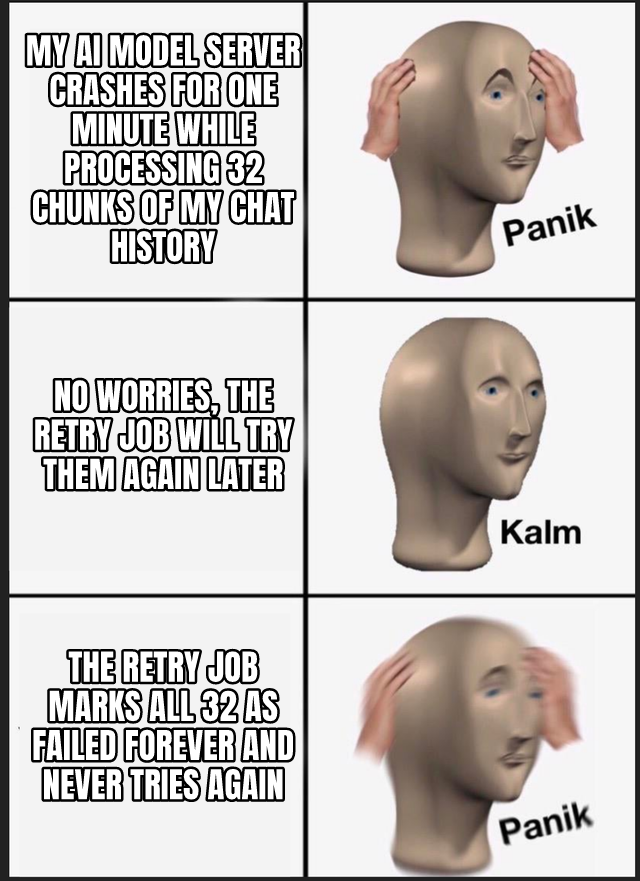

[Membral](https://github.com/surajtripathy07/membral), a tool I build, saves your AI coding chat history so you can search it later. To make that history searchable, a small model running on my own machine turns each saved chunk of text, stored as one row in a database, into a vector, a list of numbers that captures what the text means. When that step fails, a retry job tries the chunk again later, but in review I found it gave up on a chunk forever after a single failure, even when the model server was only briefly down. The server had just returned a 500 error, a generic "something broke on my side" reply, on a batch of 32 chunks, so one bad minute would have left 32 good rows unsearchable for good. Fix: give up on a chunk only when the chunk itself is the problem, such as input the model rejects or text too long for it, and otherwise skip it and report it as waiting for the next run.

A retry job should forgive a bad minute, not the chunk.

Names in this post, explained: https://surajtripathi.info/drops/
