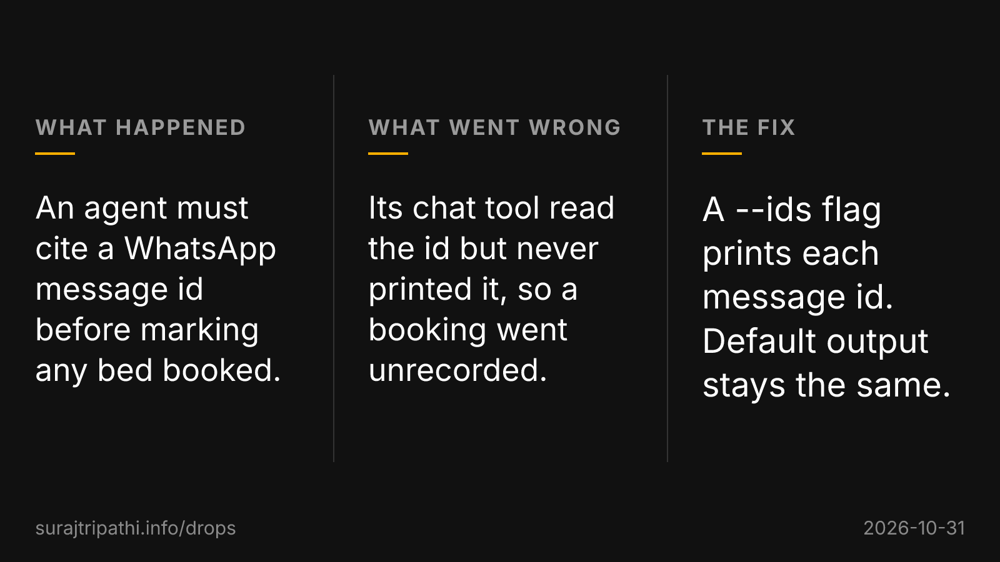

Don't like this format. Also try to ensure we don't reuse the same meme consecutively.

Also the drop looks shallow. Its nice in that it shows that the agent is doing cool things, but fix for ids does not resolve the tension, also the problem doesn't feel too big, and the resolution fails to land/impress
