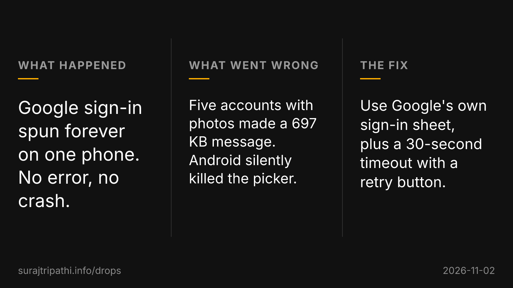

Google sign-in in an Android app I build spun forever on one phone, with no error and no crash. The phone had five Google accounts, and Android was passing its account picker, the system screen where you choose an account, every one of them along with its profile picture.

That came to 697 KB in a single message between two processes, which is over Android's size limit for one message, so the system killed the picker as it opened and never told the app. Fix: ask Google's own sign-in sheet instead, which never builds that list, and add a 30-second timeout that shows an error and a retry button.

A spinner with no timeout is a bug report nobody can file.

[What drops are, and the names in them](https://surajtripathi.info/drops/)
