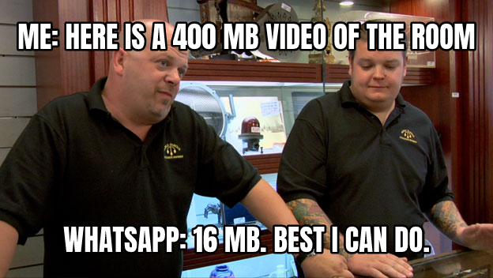

WhatsApp won't deliver a video over 16 MB, and phone videos of a room blow past that. Sally, the WhatsApp agent that sells beds in my paying-guest hostels in Mumbai, sends those videos to people asking about a bed, so every oversized clip was a send that could never go out.

I built a small owner-only web page for uploading them. It now takes files up to 500 MB and re-encodes anything over 16 MB, or not already in the common mp4 format, with ffmpeg, the standard command-line video converter.

The trick is a size budget worked out from the clip's length: 15 MB in bits, divided by its length in seconds, minus 128 kilobits per second for the sound, gives the sharpest video that still fits. The same math says when to stop: below 300 kilobits per second, which is a clip of roughly five minutes, the page refuses and asks me to trim it.

A blurry room tour that technically fits sells nothing.

[What drops are, and the names in them](https://surajtripathi.info/drops/)
