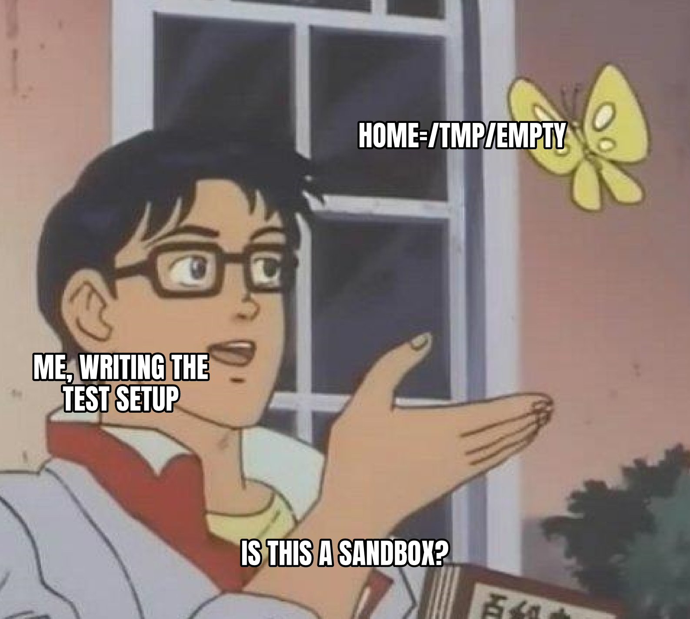

The usual way to test a command-line tool without touching your real setup is to point HOME, the variable that names your home folder, at an empty temp folder. Before doing that with [Membral](https://github.com/surajtripathy07/membral), the memory layer I build that saves your AI coding sessions so you can search them later, I had an agent trace what its one-step local install really touches.

The trace, through lines 437 to 455 of setup.ts, showed the install registers a background job with launchd, the macOS service that starts programs for you, under one fixed name in my real user account. launchd never reads HOME, so my "sandboxed" test would have quietly replaced the real job that feeds my own Membral and pointed it at a throwaway folder.

Fix so far: test runs now use their own Docker project name, so their containers and stored data get separate names and cannot overwrite my real ones. The launchd step stays out of tests until it gets its own off switch, because a temp HOME only hides files, not system services.

A fake home folder doesn't fool the operating system.

[What drops are, and the names in them](https://surajtripathi.info/drops/)
