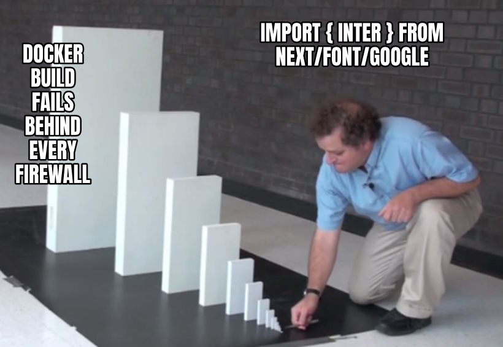

A build that secretly needs the internet will break the first time it runs on the wrong network. [Membral](https://github.com/surajtripathy07/membral), the memory layer I build for AI coding sessions, ships as a Docker image that people build and run on their own machines.

Its web app loaded fonts through next/font/google, a Next.js helper that downloads the font files from Google during the build. So a build behind a firewall, or with no internet at all, would fail before the app ever started, and nothing in the code looked like a network call.

I switched to next/font/local and committed the files to the repo instead: 9 font files, 405,792 bytes, plus their 6 licence files. Then I tested it by building with the network proxy set to 127.0.0.1:9, a port on my own machine where nothing answers, so any download fails, and the build still finished cleanly.

If you want to know what your build downloads, take its network away.

[What drops are, and the names in them](https://surajtripathi.info/drops/)
