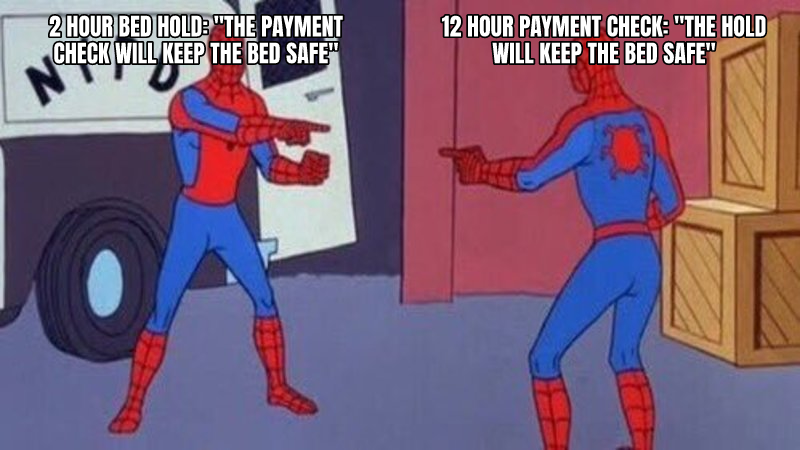

Two timeouts can each make sense on their own and still sell the same thing twice. I'm designing the booking flow for Sally, the WhatsApp agent that sells beds in my paying-guest hostels in Mumbai, and when someone wants a bed she holds it for 2 hours while they pay a token, a small deposit that secures it.

Separately, I have up to 12 hours to confirm the token actually reached my account. So a tenant pays in hour one, the hold runs out in hour two, Sally offers the bed to the next person who asks, and my "received" tap in hour ten lands on a bed that is already gone.

The design also had no way to move a bed from open back to reserved, so nothing could undo the mistake, and a token of Rs 5,000 or more would sit with me with no bed behind it. An adversarial review found this before any code shipped.

That review is a second AI given one job: break the design.

Now, once a tenant sends a payment reference and a screenshot, the hold stops having a clock. The bed stays held until I answer or an admin decides.

Every timeout decides who loses when someone is slow.

[What drops are, and the names in them](https://surajtripathi.info/drops/)
