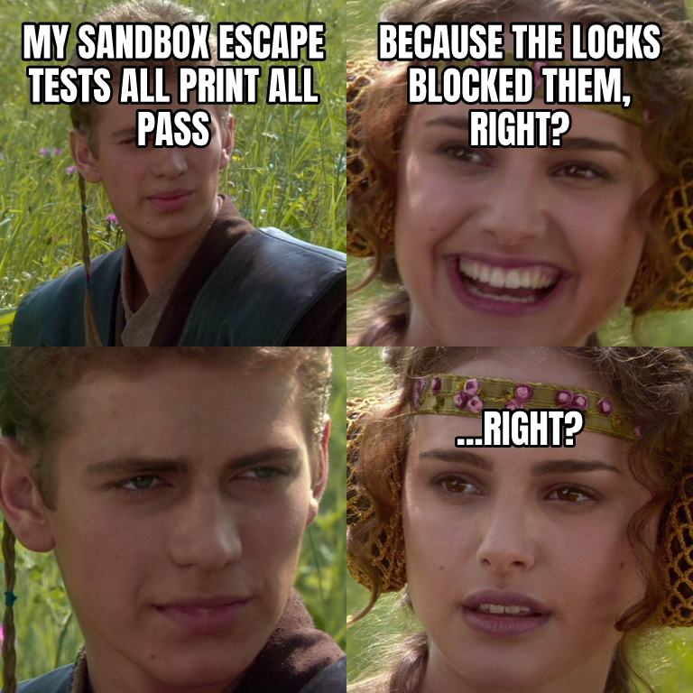

You can test a sandbox by asking an AI agent to break out of it, but a refusal tells you less than it seems. I'm building Foreman, an agent that will run on its own at 02:00 and 15:00 every day and may only write inside its own folder.

It has three locks: a guard script that checks every command before it runs, an allow list in its settings that names the tools it may use, and an operating-system sandbox. With all three on, my four escape tests (write outside the folder, fetch a web page, read a private config file, write inside the folder) printed ALL PASS.

So I turned the locks off one at a time and ran the tests again. The allow list named only two kinds of helper agent that Foreman could start, yet with the guard script off, a third, general-purpose helper started without trouble, because the list never blocked anything it didn't name.

Two other refusals came from the test model choosing caution on its own, not from any rule, so they proved nothing either. The fix is explicit deny rules for every other helper type, and Foreman stays off the schedule until each lock has been seen refusing on its own.

A refusal only counts if you know who refused.

[What drops are, and the names in them](https://surajtripathi.info/drops/)
