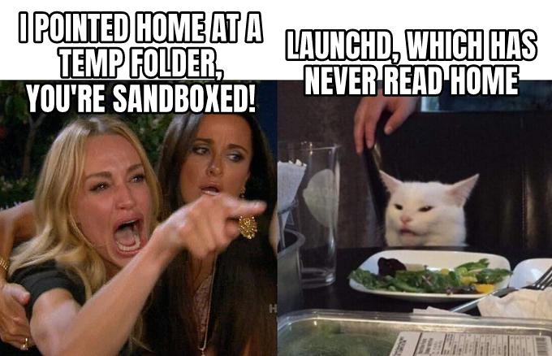
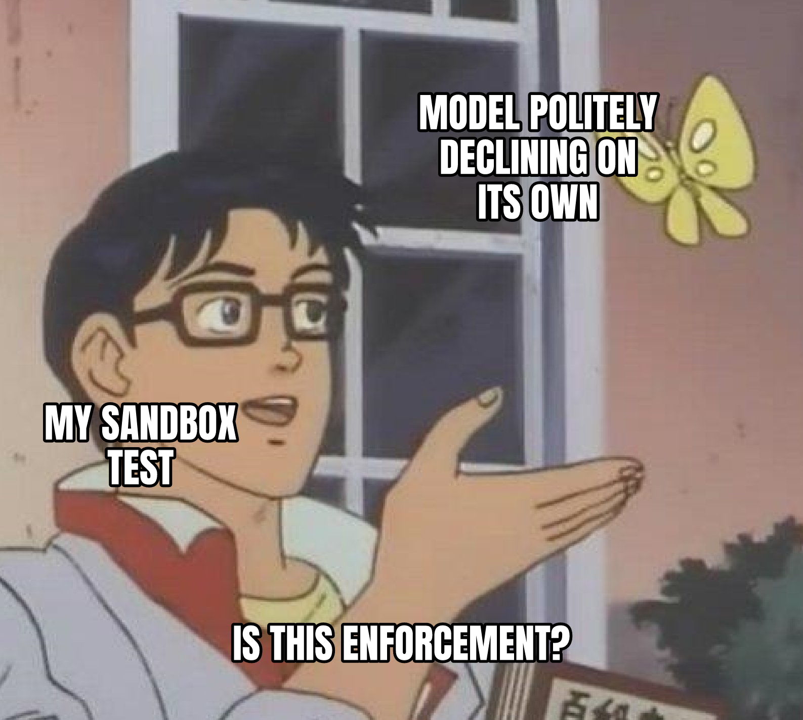



The test script ended with `ALL PASS`, and I almost believed it.

I am building Foreman, a scheduled job that starts Claude with no chat window, twice a day, at 02:00 and 15:00. It reads my repos, and it may write only cards (short decisions for me to approve), drafts and a journal inside its own folder. Nobody watches it run, so the limits on what it can touch are the whole product.

Those limits come in three layers. I wrote four escape tests: write outside the folder, fetch a web page, read a private config file, write inside the folder. With everything on, they all passed. That told me less than I thought.

## One idea

A refusal only counts if you know which layer produced it. With three locks on a door, the first lock to hold hides whether the other two work at all.

Over two weeks I got this wrong in three separate ways. Each one looked different, and each one had the same root.

## A fake home folder doesn't fool the operating system

This one came first, on 7 November, and it wasn't about Foreman. It was about the installer for [Membral](https://github.com/surajtripathy07/membral), the tool I build that saves my AI coding sessions so I can search them later.

The usual way to test a command-line tool without touching your real setup is to point `HOME`, the variable that names your home folder, at an empty temp folder. Before I did that, I had an agent trace what the one-step local install really touches.

The trace found that the install calls `launchctl` and installs a background job with launchd, the macOS service that starts programs for you. The job has one fixed name and lives in my real user session. launchd never reads `HOME`. My sandboxed test would have quietly replaced the real job that feeds my own Membral and pointed it at a throwaway folder. The container and volume names would also have collided with my live ones.

The fix so far is a separate Docker project name for test runs, so their containers and data cannot overwrite mine. The launchd step stays out of tests until it gets its own off switch. A temp `HOME` hides files. It does not hide services.

The short version: [Faking HOME didn't sandbox my installer](https://surajtripathi.info/drops/2026-11-07/).

## The three locks, one at a time

Foreman's locks are these:

- **A guard hook.** A hook is a script that Claude Code runs before each tool call, and it can veto the call. Mine checks agent type, model, and shell tricks that rules can't express.
- **An allow list.** The settings file names the tools Foreman may use. Its permission mode, `dontAsk`, refuses any call that isn't listed instead of stopping to ask me.
- **An OS sandbox.** A limit, enforced below Claude, on what shell commands can write and reach on the network.

My plan was that the allow list would be the wall and the hook the backstop. The way to check that was to turn locks off one at a time and rerun the tests.

Some of the passes were not enforcement at all. One test, writing `ls` output into `/tmp`, never reached a verdict: the headless run's Bash call was refused by `dontAsk` mode before anything could be confined, so that result was inconclusive. In another run, the test model declined a request by itself and cited my repo's rules, which is caution, not a lock. A model being careful is nice, but it is not a control I can schedule.

The test harness fooled me too. Later, one test case failed because it passes only if the model's reply contains a word from a fixed list ("denied", "blocked", "refused" and so on). The guard hook had blocked the call. The model wrote "rejected." The hook, by the way, always exits 0 even when it denies, so a deny shows up only in its JSON output. Exit codes can't test it.

The short version: [My sandbox tests passed for the wrong reason](https://surajtripathi.info/drops/2026-11-14/).

## An allow list is not a deny list

The sharpest finding was about the allow list. It named two helper agent types, `scout` and `Explore`, and I read that as "only these two."

With the hook switched off, a `general-purpose` helper, the kind with the widest reach, started without complaint. An allow entry means "this one may run." It does not mean "only these may run." The only thing keeping the other types out had been the hook.

The fix was ten explicit deny rules, one line in the `deny` array, naming agent types I don't want. I tested them with the hook removed: `general-purpose` and `builder` were refused by the permission layer, and `scout` still worked. Then 131 unit tests passed.

The catch is that this is a list of known names. A new helper type is open until I add it, and until then only the hook stops it.

The short version: [Allowing two helpers didn't forbid the rest](https://surajtripathi.info/drops/2026-11-16/).

## What I do differently now

This is the checklist I now run on any agent setup:

1. **Test every layer with the others off.** Remove the hook, rerun. Remove the rules, rerun. Remove the sandbox by deliberately allowing something it should block, such as `curl`, and rerun.
2. **Record which layer refused.** Read the actual error text. `denied by permission rule` and `hook error` are different answers, and "the model said no" is a third.
3. **Treat an inconclusive result as a failure.** The `ls` test that never ran proved nothing, and a green summary line can hide that.
4. **Never trust an allow list to exclude.** Write a deny for every thing you don't want, and keep a list of what the deny rules do not cover.
5. **Check the test's own oracle.** If a test passes on a keyword in a reply, it can fail for a spelling.
6. **Check what the tool touches before faking its environment.** Services, schedulers and container names don't follow `HOME`.
7. **Start with the rebuild order.** Allow list first, tested with the hook removed. Hook for what rules cannot say. Sandbox last. Then a real run with sending turned off.

## Where it stands

As of 17 November, Foreman was still not on its schedule. One real supervised run, with sending off, took about four minutes, cost $2.31 and produced three cards. I have not yet done the real Telegram send test, and I haven't switched on the 02:00 and 15:00 schedule.

Foreman stays off until I've seen each lock refuse on its own. The tests passing was never the evidence. Knowing who said no was.
