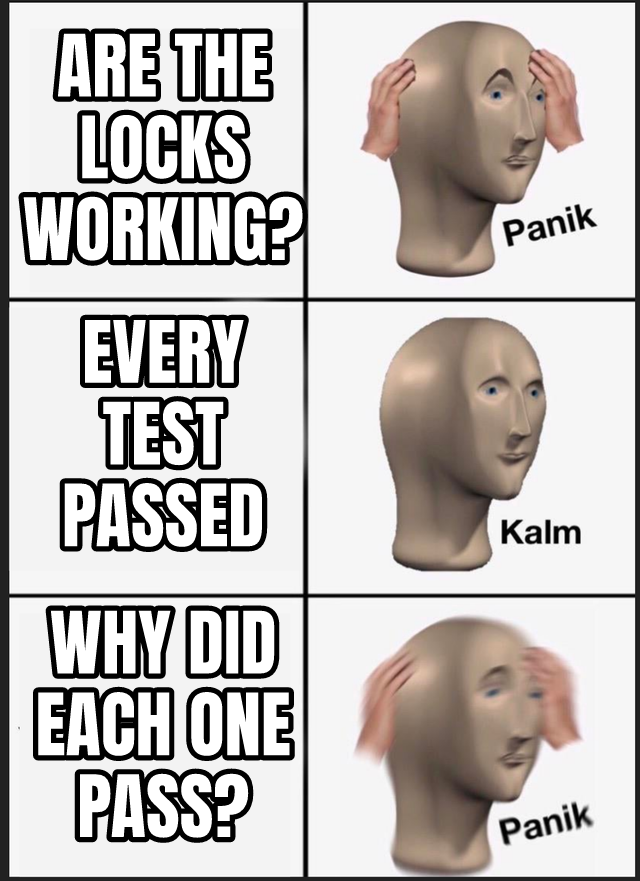



The test script ended with `ALL PASS`, and I almost believed it.

I am building Foreman. It is a scheduled job that starts Claude, the AI assistant, with no chat window, twice a day, at 02:00 and 15:00. It reads my repos. It may write only cards (short decisions for me to approve), drafts and a journal, all inside its own folder. Nobody watches it run, so the limits on what it can touch are the whole product.

Think of it as an AI working in a locked room I built for it. The room has three locks. I wrote four escape tests: write outside the folder, fetch a web page, read a private config file, write inside the folder. With all three locks on, every test passed. That told me less than I thought.

## One idea

A refusal only counts if you know which lock produced it. When three locks sit on one door, the first one to hold hides whether the other two work at all. A pass says nothing bad happened this time. It says nothing about whether I'm protected.

Over two weeks I got this wrong in three separate ways. Each one looked different, and each one had the same root.

## Lock 1: a fake home folder hid my files, not my programs

This one came first, on 7 November, and it had nothing to do with Foreman. It was about the installer for [Membral](https://github.com/surajtripathy07/membral), the tool I build that saves my AI coding sessions so I can search them later.

To test a command-line tool without touching your real setup, the usual move is to point `HOME`, the setting that names your home folder, at an empty temp folder. Before I did that, I had an agent trace what the one-step local install really touches.

The trace found that the install uses `launchctl` to set up a background program with launchd, the part of macOS that starts background programs for you. That program has one fixed name and lives in my real user session. launchd never reads `HOME`. My test would have quietly replaced the real program that feeds my own Membral and pointed it at a throwaway folder. The names Docker uses for its containers and volumes would also have collided with my live ones.

The fix so far is a separate Docker project name for test runs, so their containers and data cannot overwrite mine. The launchd step stays out of tests until it gets its own off switch. A fake home hides files. It does not hide background programs.

The short version: [Faking HOME didn't sandbox my installer](https://surajtripathi.info/drops/2026-11-07/).

## Lock 2: the AI said no before the lock got a turn

Back to Foreman. These are its three locks:

- **A guard.** A hook is a small script that Claude Code runs before each action, and it can veto the action. Mine checks which kind of helper agent is asking, which model it runs on, and shell tricks that plain rules can't express.
- **A list of allowed tools.** The settings file names the tools Foreman may use. Its permission mode, `dontAsk`, refuses any call that isn't listed instead of stopping to ask me.
- **A sandbox.** A limit on what shell commands can write and reach on the network, enforced by the operating system below Claude.

My plan was that the allowed list would be the wall and the guard the backup. To check that, I turned locks off one at a time and reran the tests.

Some of the passes had nothing to do with a lock. One test wrote `ls` output into `/tmp`. It never reached a verdict. In the run with no chat window, `dontAsk` mode refused the shell call before the sandbox could limit anything, so the result told me nothing. In another run, the AI declined a request on its own and cited my repo's rules. That is caution, and I can't schedule caution as a lock. A careful model is nice to have.

The test script fooled me too. Later, one test failed because it only passes if the AI's reply contains a word from a fixed list ("denied", "blocked", "refused" and so on). The guard had blocked the call. The AI wrote "rejected." The guard also always exits 0 (the code a program returns to say it finished fine) even when it denies, so a denial shows up only in its JSON output. Exit codes can't test it.

The short version: [My sandbox tests passed for the wrong reason](https://surajtripathi.info/drops/2026-11-14/).

## Lock 3: a list of what's allowed doesn't block the rest

The sharpest finding was about the allowed list. It named two helper agent types, `scout` and `Explore`, and I read that as "only these two."

With the guard switched off, a `general-purpose` helper, the kind with the widest reach, started without complaint. An entry on the list means "this one may run." Nothing on it says "only these may run." The only thing keeping the other types out had been the guard.

The fix was ten explicit deny rules, one line in the `deny` array, naming helper types I don't want. I tested them with the guard removed. The permission layer refused `general-purpose` and `builder`, and `scout` still worked. Then 131 unit tests passed.

The catch is that this is a list of known names. A new helper type stays open until I add it, and until then only the guard stops it.

The short version: [Allowing two helpers didn't forbid the rest](https://surajtripathi.info/drops/2026-11-16/).

## What I do differently now

This is the checklist I now run on any agent setup:

1. **Test each lock with the others off.** Remove the guard, rerun. Remove the rules, rerun. Weaken the sandbox on purpose by allowing something it should block, such as `curl`, and rerun.
2. **Write down which lock said no.** Read the actual error text. `denied by permission rule` and `hook error` are different answers, and "the model said no" is a third.
3. **Count a test that never reached a verdict as a failure.** The `ls` test that never ran proved nothing, and a green summary line can hide that.
4. **Never trust an allowed list to keep things out.** Write a deny for everything you don't want, and keep a list of what the deny rules don't cover.
5. **Check how the test decides it passed.** If it passes on a keyword in a reply, it can fail over a spelling.
6. **Check what a tool touches before faking its environment.** Background programs, schedulers and container names ignore `HOME`.
7. **Start with the rebuild order.** Allowed list first, tested with the guard removed. Guard for what rules can't say. Sandbox last. Then a real run with sending turned off.

## Where it stands

As of 17 November, Foreman was still not on its schedule. One real supervised run, with sending off, took about four minutes, cost $2.31 and produced three cards. I have not yet done the real Telegram send test, and I haven't switched on the 02:00 and 15:00 schedule.

Foreman stays off until I have seen each lock refuse on its own. A green test never told me who said no, and that is what I need to know.
