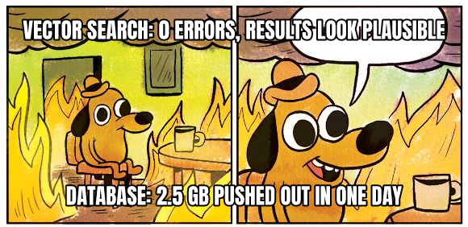
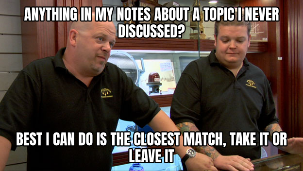
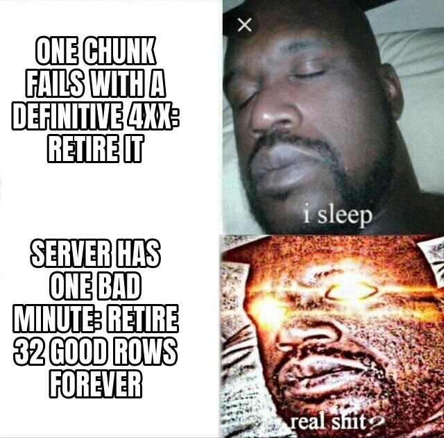



On Nov 2, one of my apps pushed about 2.5 GB of data out of my database in a single day. My hosted plan charges for that, and the free quota was gone.

The app was [Membral](https://github.com/surajtripathy07/membral), a tool I build that saves your AI coding sessions so you can search them later. The cause was not a crash or a bad query result. It was a design choice that only costs money at scale.

That turned out to be the pattern for the three bugs in this post. A vector search store, the kind that finds text by meaning instead of by keyword, rarely throws an error when it goes wrong. It returns something plausible, or it quietly stops doing its job, or it costs more than it should. Each bug below was a different version of that.

A quick glossary, since the rest depends on it. An embedding is a list of numbers that captures what a piece of text means; texts with similar meaning get similar lists. A vector search compares those lists and returns the closest ones. pgvector is the Postgres extension that lets the database do that comparison itself.

## Every save downloaded every lesson

When Membral saves a new lesson from a session, it first checks for near-duplicates by comparing embeddings. That comparison ran in my app code, not in the database. So each save job pulled every stored lesson in the project down to the app, twice, at about 19.4 KB each.

On a project with about 2,000 lessons, that is roughly 79 MB per job. All of it was thrown away, because the check only needs the closest few matches. Egress is the data that leaves the database, and I was paying for 79 MB of it to keep a handful of rows.

The code is correct at any size. It only hurts when the store grows, and then it shows up on an invoice.

The fix is one query. Postgres with pgvector can rank every stored vector against the new one and return only the nearest few, so the rest never leave the database.

**Send the question to the data, not the data to the question.**

([The short version](https://surajtripathi.info/drops/2026-11-04/) is a drop I wrote at the time.)

## Search never says nothing found

Ask a keyword search for a word that isn't in your documents and you get an empty list. Ask a meaning-based search about something you never discussed and it still hands back the closest match, however far off. Closest is all it knows how to compute.

So you need a cut-off: a minimum closeness score, from 0 to 1, that a result must reach before it is shown. I tested candidate cut-offs against 6 questions that have no true answer in my history. For each of those, the right result was an empty list.

Lower cut-offs let a wrong match through on at least one of the 6. For raw chat text, only 0.68 returned nothing on all 6. The short notes Membral pulls out of those chats work at 0.66. Raw chat is noisier, so it has to clear a higher bar.

The embedding model matters here too. Membral uses a small embedding model, nomic-embed-text, running on my own machine. When I looked at the chat search code, it had a cut-off of 0.3 hard-coded, and that number belonged to the old OpenAI embedding model I had used before. Scores from different models are not on the same scale. The calibrated cut-offs for the new model were sitting unused, and chat search fell back to keywords only for it. No error, just a weaker search.

**A cut-off belongs to a model and a kind of text, so measure it on questions you know have no answer.**

([The short version.](https://surajtripathi.info/drops/2026-11-03/))

## A retry job that retired good rows

To make text searchable, that local model turns each saved chunk into a vector. Sometimes that step fails, so a retry job tries the chunk again later.

In review I found the job gave up on a chunk forever after a single failure. That included a brief outage of the model server. The server had just returned a 500, a generic "something broke on my side" reply, on a batch of 32 chunks. One bad minute would have left 32 good rows without vectors for good, and since retired rows were never picked up again, nothing would have said so.

The fix is to separate "this chunk is the problem" from "the server is having a moment". In the re-embed command, a row is retired only on a definitive per-text 4xx error (not 401, 403, 404, 408 or 429) or on text too long for the model that cutting it down cannot fix. A 500, a timeout, or no status at all leaves the row untouched, and the run reports it as deferred. A re-run picks it up.

The retired rows are the quiet part. They are not errors in any log you read. They are rows that never show up in search, and you find out when someone asks a question the missing row would have answered.

**A retry job should forgive a bad minute, not the chunk.**

([The short version.](https://surajtripathi.info/drops/2026-10-30/))

## If you run your own pipeline

Three checks, one per bug:

- Look at what your similarity check downloads per call. If the app computes closeness, count the bytes that leave the database.
- Test your cut-off on questions that have no answer. Pick them before you tune, and recheck whenever you change the model or the kind of text.
- List what your retry path gives up on. For each permanent failure, ask whether the input is bad or the service was.

## What I took from it

None of these three showed up as an exception. They showed up as a bill, a wrong answer shown with confidence, and rows missing from results. If the failure is quiet, the test has to be written to hear it: a size count, a question with no answer, a simulated outage.
